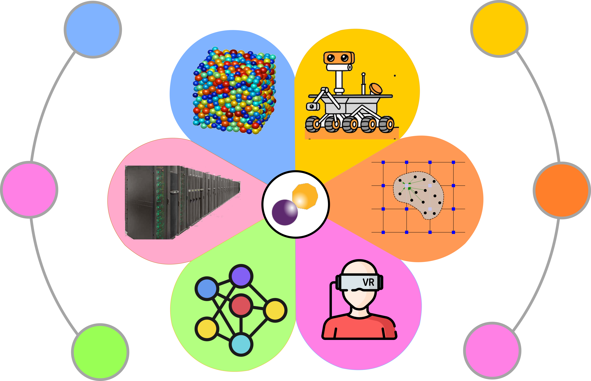

Geoelements is Krishna Kumar's research group in Civil and Environmental Engineering at UC Berkeley. We develop computational methods that help robots predict and act in unfamiliar physical environments. Our work combines computational mechanics, machine learning, and robotics, with a focus on deformable materials and complex physical interactions.

We infer material behavior from limited observations and use the identified models for fast prediction, planning, and control. The goal is a world model that adapts its predictions as a robot meets new materials and interactions. Applications include construction automation, soft-material manipulation, navigation on deformable terrain, lunar excavation, and natural hazards.

  

    
  

  

    
<b>Physics-grounded perception</b>: 3D Gaussian Splatting and weak-form mechanics identify material laws from observed motion.

    
<b>Adaptive learned simulators</b>: Graph network simulators and neural operators generalize to unfamiliar materials.

    
<b>Differentiable world models and control</b>: Differentiable physics and function encoders support fast planning and online adaptation.

    
<b>Embodied autonomy</b>: Physically viable world models guide robotic construction, manipulation, and terrain navigation.

    
<b>AI for engineering and natural hazards</b>: Chishiki.ai and DesignSafe provide open research infrastructure.

  

